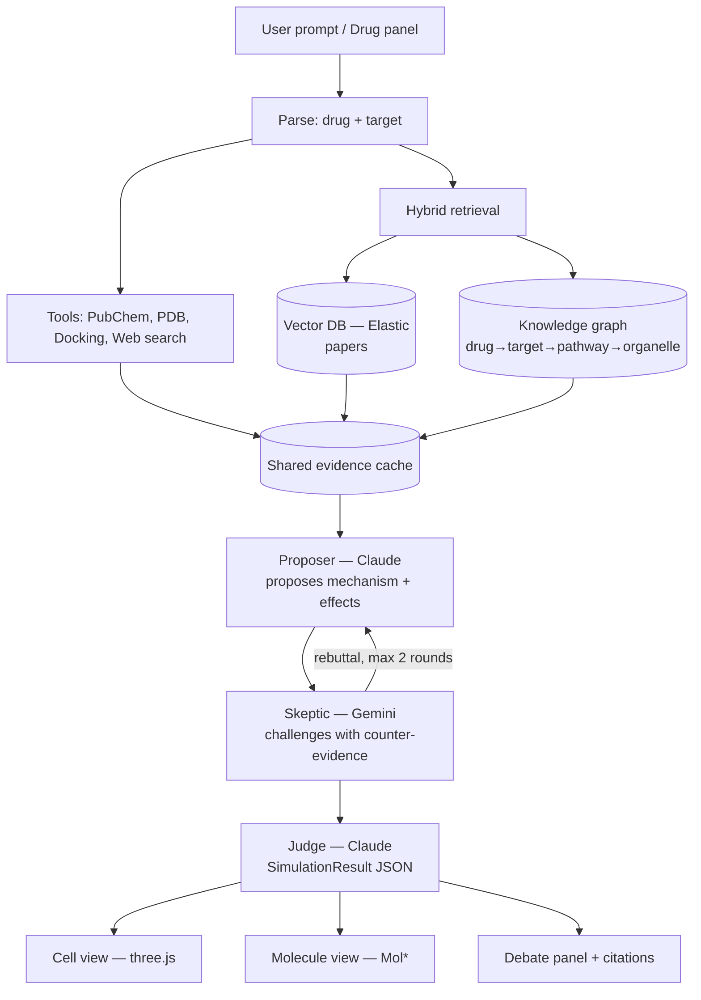
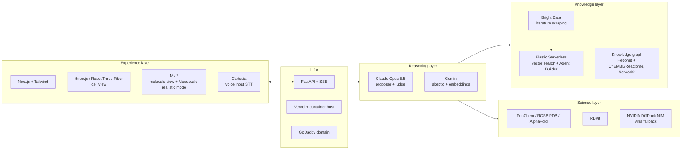

# Mol — Execution Doc (Cal Hacks 13.0)

> After approval, this doc is published as a **Claude Doc** (shareable with the team) and saved in the repo as `docs/EXECUTION_PLAN.md`. Everything below is the content.

## 0. Context
**Problem:** Early drug and vaccine discovery is slow, and researchers struggle to *see* and *trust* what a compound does inside a cell.
**Product:** Mol. A user applies a drug to a cell, by prompt or through a panel. A 3-agent AI debate reasons over real biological data and predicts the effect. The result is shown in 3D at two layers, a cell view that zooms into a molecular binding view. The full reasoning, citations and confidence levels are visible.
**Constraints:** Submission due **Oct 25, 9:00am PDT**, from a team of 2–4. It needs a GitHub repo, a project image, a smooth live demo and a 2–3 minute video.
**Target tracks:** Anthropic Claude for Public Benefit (primary) · People-First Social Impact · Most Technically Advanced · MLH Gemini · Elastic Agent Builder · Bright Data · Cartesia · GoDaddy domain.

## 1. Architecture
```
Next.js (web/)                              FastAPI (api/)
├─ PromptBar + DrugPanel ──POST /simulate──▶ Debate orchestrator (SSE stream)
├─ CellScene (R3F/three.js)                  ├─ Proposer  — Claude Opus 5.5 (Tool Runner)
├─ MoleculeView (Mol*)                       ├─ Skeptic   — Gemini (function calling)
├─ DebatePanel (streamed turns, citations)   ├─ Judge     — Claude Opus 5.5 (structured output)
└─ Voice input (Cartesia STT)                ├─ Evidence cache (tools run once, shared)
                                             ├─ Tools: get_drug, get_target, run_docking,
                                             │         search_literature, query_graph, web_search
                                             ├─ Elastic Serverless (vector + hybrid search)
                                             ├─ Knowledge graph (NetworkX: drug→target→pathway→organelle)
                                             ├─ Bright Data ingestion (PubMed / ClinicalTrials)
                                             └─ RDKit + DiffDock NIM (Vina fallback); cache/ precomputed demos
```

### AI pipeline flow


## 2. Technology map (pitch prep)

### Map by layer


### What each technology does, and why
| Technology | Used for | Why this choice (pitch line) | Sponsor track |
|---|---|---|---|
| **Claude Opus 5.5** | Proposer agent (tool use, web search) and judge agent (structured `SimulationResult`) | Strongest at long, multi-step tool use and careful reasoning, and it can show its thinking. The judge's structured output means the 3D view never gets malformed data. | Anthropic Claude for Public Benefit |
| **Gemini** | Skeptic agent, embeddings, Google Search grounding | A *different* model as the critic gives real disagreement, not one model agreeing with itself. That cuts down hallucinations. | MLH Best Use of Gemini |
| **Elastic Serverless + Agent Builder** | Vector and hybrid (BM25 + kNN) search over papers; Literature Agent | Hybrid search catches both exact drug names and semantic matches, and every answer links to a PMID. | Elastic Agent Builder |
| **Knowledge graph (NetworkX)** | Drug→target→pathway→organelle chains; off-target lookup | Biology is a network. The graph gives multi-hop reasoning and the visible reasoning path in 3D. | Technically Advanced |
| **Bright Data** | Scraping PubMed and ClinicalTrials.gov into the knowledge base | Keeps the knowledge base fresh with public web data, not a static dataset. | Bright Data |
| **PubChem / RCSB PDB / AlphaFold** | Drug structures and properties; protein 3D structures | The same open data real researchers use. No invented molecules. | — |
| **RDKit** | Drug properties (MW, logP, Lipinski), 3D conformers | The industry-standard cheminformatics toolkit. | — |
| **NVIDIA DiffDock NIM** (Vina fallback) | Binding pose and confidence for drug + protein | Grounds the AI in a structure-based model. The binding is computed, not imagined. | Technically Advanced |
| **Hetionet / PrimeKG** | A prebuilt biomedical knowledge graph as the seed of our graph | Built from 29+ curated databases. We reuse what science already connected. | — |
| **three.js / React Three Fiber** | Stylized cell, organelles, drug particles, effect animations | Turns abstract predictions into something anyone can see in 5 seconds. | Most Creative |
| **Mol\*** | Protein cartoon, docked ligand, binding-site residues; **Mesoscale "realistic mode"** (cellPACK virion/cell models) | The same viewer RCSB PDB and PDBe use, at research quality. Mesoscale shows real molecular crowding. | — |
| **Cartesia** | Speech-to-text so users can speak the drug/query instead of typing | Hands-free and easier for non-experts. | Cartesia |
| **FastAPI + SSE** | API and live streaming of each debate step | Users watch the AI think in real time instead of waiting on a spinner. | — |
| **Next.js, Vercel, GoDaddy** | Frontend, hosting, domain | Fast to ship, with a public URL for judges. | GoDaddy domain |

### Off-the-shelf libraries and products (don't build from scratch)
| Need | Use this instead of building | Saves |
|---|---|---|
| Biomedical knowledge graph | **Hetionet** (prebuilt drug–gene–pathway–disease–anatomy graph, JSON) or **PrimeKG** (Harvard, CSV). Filter to a subgraph around the 5 presets and load into NetworkX. | Most of the graph-building work |
| Docking / binding prediction | **NVIDIA BioNeMo NIM APIs** (build.nvidia.com): **DiffDock** for poses (Boltz-2 for affinity if available). Hosted, free credits, no local install. Presets cached. | Vina/Meeko setup and receptor prep |
| Protein structure for non-preset targets | **AlphaFold DB API**, or the **ESMFold** NIM | Folding |
| Bio data access | `pubchempy`, `chembl_webresource_client`, `biopython` (Entrez/PubMed, PDB parsing), `bioservices` (UniProt, Reactome, KEGG) | Writing REST clients |
| Literature | **Europe PMC REST** (full-text and abstracts, free) + **Bright Data** for ClinicalTrials.gov and news (track) | Scraper code |
| Embeddings / chunking | Elastic **`semantic_text`** field (built-in inference handles chunking and embedding at index time) | The embed pipeline |
| Agent loop | Anthropic SDK **Tool Runner** (`@beta_tool`) + `google-genai` automatic function calling | Hand-written loops |
| Bio MCP tools (optional) | **BioMCP** (PubMed, ClinicalTrials, variants as MCP tools) | More tool wrappers |
| Cell 3D model | A CC-licensed animal-cell **GLB** from **NIH 3D** (3d.nih.gov) or Sketchfab, loaded with drei `useGLTF`; organelles become meshes by name | Modeling organelles |
| 3D effects | `@react-three/drei`, `@react-three/postprocessing` (Bloom for glow), `maath` (easing) | Shader work |
| Molecule viewer | **Mol\*** (`molstar` npm, plugin UI) or the **`pdbe-molstar`** web component for the quickest embed; 3Dmol.js as the emergency fallback | A molecule renderer |
| Realistic cell (stretch) | **Mol\* Mesoscale Explorer** + **cellPACK** models (e.g. a whole-cell mesoscale model) | Building a mesoscale model |
| UI components | **shadcn/ui** (panels, chat bubbles, badges), **framer-motion**, **react-force-graph-2d** (reasoning graph) | UI work |
| Voice input | **Cartesia STT** (server-side via the `cartesia` Python package; browser `MediaRecorder` for mic capture) | Audio capture and upload code |
| Python hosting with RDKit | **Modal** or **Render** (Docker) | Ops |

Rule of thumb: our own code is **only** the debate orchestration, the `SimulationResult` contract, and the result-to-3D animation mapping. Everything else is glue.

### 30-second pitch skeleton
1. **Problem:** understanding what a drug does inside a cell is slow, scattered across thousands of papers, and hard to see.
2. **What it is:** Mol lets you drop a drug onto a 3D cell and watch AI agents debate what happens, grounded in real data.
3. **How:** Claude proposes, Gemini challenges, and Claude judges. Evidence comes from docking physics, a biology knowledge graph and thousands of papers.
4. **Trust:** every effect is tagged agreed, disputed or speculative, with citations, and you can see the reasoning path in 3D.
5. **Impact:** faster hypothesis triage for drug discovery and repurposing, and a clearer way to teach pharmacology.

### Core data contract: `SimulationResult`
Defined once as a Pydantic model in `api/schemas.py` and mirrored as a TS type in `web/lib/types.ts`.
```
drug:      { name, smiles, cid, mw, logp }
targets[]: { name, uniprot, pdb_id, cell_location: membrane|cytoplasm|nucleus|mitochondria|er,
             binding_score_kcal, pose_pdb_url }
effects[]: { pathway, organelle, direction: up|down|block, magnitude: 0..1,
             status: agreed|disputed|speculative, confidence: 0..1, explanation, source_ids[] }
debate[]:  { agent: proposer|skeptic|judge, round, text, source_ids[] }
reasoning_path[]: { from, relation, to, source_id }   # graph hops behind the conclusion
citations[]: { id, title, url, pmid? }
caveats[]: string
```

---

## Phase 1: Scaffold and foundations (~1h)
**Expected result:** `pnpm dev` (web on :3000) and `uv run fastapi dev` (api on :8000) both start. The web page shows an empty 3-panel layout, and `GET /health` returns `{ok:true}`. Keys load from `.env`.

**Implementation**
- `web/`: `create-next-app` (TS, App Router, Tailwind). Install `three @react-three/fiber @react-three/drei @react-three/postprocessing molstar zustand framer-motion`, and run `npx shadcn init`.
  - `app/page.tsx` has a 3-column layout: left DrugPanel, center 3D canvas, right DebatePanel.
  - `lib/store.ts` holds a Zustand store: `{ input, status, debate[], result, view: 'cell'|'molecule', selectedTarget }`.
- `api/`: `uv init`, then add `fastapi sse-starlette anthropic google-genai elasticsearch rdkit pubchempy chembl_webresource_client biopython bioservices networkx cartesia httpx pydantic pytest`. Add `vina meeko` only if the fallback is needed.
  - `main.py` serves `/health`, `/simulate` (SSE) and `/presets`, with CORS for :3000.
  - `schemas.py` holds the `SimulationResult` Pydantic models.
- `.env.example` lists `ANTHROPIC_API_KEY, GEMINI_API_KEY, ELASTIC_URL, ELASTIC_API_KEY, BRIGHTDATA_API_KEY, CARTESIA_API_KEY, NVIDIA_API_KEY`.
- Root `README.md` gives the project summary and how to run it.

**Docs**
- Next.js: https://nextjs.org/docs · Tailwind: https://tailwindcss.com/docs
- FastAPI: https://fastapi.tiangolo.com · sse-starlette: https://github.com/sysid/sse-starlette
- uv: https://docs.astral.sh/uv/ · Zustand: https://zustand.docs.pmnd.rs

---

## Phase 2: Knowledge base (RAG) (~2h)
**Expected result:** An Elastic Serverless index `mol-literature` holds 300–1,000 chunks from PubMed abstracts and ClinicalTrials.gov for the 5 demo targets. `search_literature("atorvastatin HMG-CoA reductase mechanism")` returns its top 5 chunks with PMID, title and URL. An Elastic Agent Builder "Literature Agent" answers questions over the index.

**Implementation**
- `api/ingest/scrape.py`: Bright Data (Web Scraper API or SERP API) pulls PubMed and ClinicalTrials.gov pages for queries such as `"<drug> <target> mechanism"`. NCBI E-utilities serve as a free fallback.
- `api/ingest/chunk_embed.py`: split into chunks of about 800 tokens with overlap, embed with Gemini `gemini-embedding-001`, and keep `pmid`, `title`, `url`, `drug`, `target` metadata.
- `api/ingest/index.py`: create an index with a `dense_vector` field plus a `text` field. Bulk upload.
- `api/tools/literature.py`: `search_literature(query, k=5)` runs a hybrid search (BM25 + kNN) and returns citations.
- In Kibana Agent Builder, create the "Mol Literature Agent" with an index search tool. The proposer can call it through its API or MCP endpoint. This qualifies for the Elastic track.
- **Knowledge graph (lite GraphRAG, about 2h).** It is built from curated databases, not LLM extraction.
  - **Start from Hetionet** (or PrimeKG): download it, filter to a 2-hop neighborhood of the 5 drugs, and map anatomy and cellular-component nodes to our organelles. Then fill gaps:
  - `api/ingest/build_graph.py` pulls edges for the 5 presets plus their neighbors: ChEMBL (drug -binds-> target, with activity values), UniProt (target -located_in-> organelle), Reactome (target -participates_in-> pathway, pathway -occurs_in-> organelle) and pathway -leads_to-> phenotype for the key pathways. Off-target edges from ChEMBL feed the skeptic.
  - Each node is `{id, type: drug|target|pathway|organelle|phenotype, name}` and each edge is `{relation, source_db, evidence_url}`. Store it as `api/data/graph.json` and load it into NetworkX.
  - `api/tools/graph.py`: `query_graph(entity, hops=2)` returns the subgraph as triples. `find_path(drug, organelle)` returns the shortest explanatory path.
  - Hybrid retrieval: graph hops give the structure, then each hop's entities feed `search_literature` to fetch supporting papers.

**As built (deviations from the original plan)**
- Embeddings: Gemini `gemini-embedding-001` (768 dims) in a `dense_vector` field, not `semantic_text`. It works on any Elastic deployment, including a local Docker test cluster, and adds to the Gemini track. Hybrid ranking combines BM25 and kNN with reciprocal rank fusion in the client (`api/tools/search_index.py`), so it needs no special license.
- Sources (`api/tools/sources.py`): PubMed (NCBI Best Match plus Europe PMC abstracts) and ClinicalTrials.gov API v2 are always on. Bright Data (SERP plus Web Unlocker) adds authoritative web pages when `BRIGHTDATA_API_KEY` and its zones are set.
- `search_literature` uses Elastic when `ELASTIC_URL` is set and falls back to live PubMed on errors or empty results, so the debate never breaks.
- Knowledge graph: Hetionet v1.0 filtered to 16.6k nodes and 270k edges (`api/data/graph.json.gz`, 1.8 MB, built by `api/ingest/build_graph.py`). All five presets are in Hetionet; `build_graph.py` keeps a slot for curated, cited edges for drugs newer than 2017. GO cellular components map to the five cell regions. The agent tools are `knowledge_graph`, `mechanism_path` and `off_targets`.
- Elastic Agent Builder: set up in Kibana over the same index (see README). There is no code dependency on it.

**Docs**
- Elastic vector search: https://www.elastic.co/docs/solutions/search/vector
- Elastic Agent Builder: https://www.elastic.co/docs/solutions/search/agent-builder
- Elasticsearch Python client: https://www.elastic.co/docs/reference/elasticsearch/clients/python
- Bright Data: https://docs.brightdata.com
- Gemini embeddings: https://ai.google.dev/gemini-api/docs/embeddings
- NCBI E-utilities: https://www.ncbi.nlm.nih.gov/books/NBK25501/
- ChEMBL API: https://chembl.gitbook.io/chembl-interface-documentation/web-services · Reactome Content Service: https://reactome.org/ContentService/ · UniProt REST: https://www.uniprot.org/help/api
- NetworkX: https://networkx.org/documentation/stable/

---

## Phase 3: Bio tools and docking (~2h)
**Expected result:** Each tool works standalone and has a pytest test. `run_docking(smiles, "COX-1")` returns the best pose (SDF) plus DiffDock confidence scores (a ranking score, not kcal/mol) in under 60s. `scripts/precompute_presets.py` gathers drug, target, structure and docking evidence for all 5 presets into `api/cache/evidence/<preset>.json`.

**Implementation** (`api/tools/`)
- `drug.py`: `get_drug(name)` takes the name to a PubChem CID, SMILES and properties. RDKit computes MW, logP, H-bond donors/acceptors and the Lipinski check.
- `target.py`: `get_target(name)` uses a curated map `{name → uniprot, pdb_id, cell_location}` for the demo targets, then downloads the PDB from RCSB. The AlphaFold DB is the fallback.
- `docking.py`: `run_docking(smiles, pdb_id)`. **Primary path: the NVIDIA DiffDock NIM API** (send the protein PDB plus ligand SMILES, get ranked poses with confidence). The local Vina path below is only a fallback if time allows. RDKit builds 3D coordinates, Meeko prepares the ligand PDBQT, and the receptor is prepared from a precomputed box around the known ligand site. Vina runs with `exhaustiveness=8` and a 60s timeout, then exports the best pose as PDB.
- `cache.py`: `@cached` decorator keyed by args (JSON on disk). This also creates the shared evidence cache for the debate.
- `scripts/precompute_presets.py` runs everything for the 5 presets:

| Preset | Target | PDB |
|---|---|---|
| imatinib | BCR-ABL | 1IEP |
| aspirin | COX-1 | 6Y3C (human) |
| atorvastatin | HMG-CoA reductase | 1HWK |
| tamoxifen | Estrogen receptor alpha | 3ERT (4-hydroxytamoxifen) |
| lisinopril | ACE | 1O86 |

**Docs**
- PubChem PUG REST: https://pubchem.ncbi.nlm.nih.gov/docs/pug-rest
- RCSB downloads: https://www.rcsb.org/docs/programmatic-access/file-download-services · AlphaFold API: https://alphafold.ebi.ac.uk/api-docs
- RDKit: https://www.rdkit.org/docs/
- NVIDIA BioNeMo NIM (DiffDock): https://docs.nvidia.com/nim/bionemo/diffdock/latest/ · catalog: https://build.nvidia.com
- Hetionet: https://het.io · PrimeKG: https://github.com/mims-harvard/PrimeKG
- pubchempy: https://pubchempy.readthedocs.io · chembl_webresource_client: https://github.com/chembl/chembl_webresource_client · Biopython: https://biopython.org/docs/latest/ · bioservices: https://bioservices.readthedocs.io
- Europe PMC REST: https://europepmc.org/RestfulWebService · Elastic semantic_text: https://www.elastic.co/docs/reference/elasticsearch/mapping-reference/semantic-text
- AutoDock Vina (Python, fallback): https://autodock-vina.readthedocs.io/en/latest/docking_python.html · Meeko: https://meeko.readthedocs.io

---

## Phase 4: Debate orchestrator (AI core) (~3h)
**Expected result:** `POST /simulate {drug, target?, prompt?}` streams SSE events: `status` → `tool_call` → `turn` (proposer) → `turn` (skeptic) → optional `turn` (rebuttal) → `result` (a valid `SimulationResult`). It finishes in under 60s for presets on the live path, or about 2s when replaying from cache. On any failure it falls back to the cached preset and says so.

**Implementation** (`api/agents/`)
- `parse.py`: when the input is free text, a Claude call with structured output returns `{drug, target, cell_type}`. The UI shows these fields so the user can confirm them.
- `proposer.py`: Claude `claude-opus-5-5` through the SDK **Tool Runner** (`@beta_tool` wrappers over the Phase 3 tools plus `search_literature`, `query_graph` and `find_path`) and the `web_search_20260209` server tool. Settings: `thinking: {type:"adaptive", display:"summarized"}`, `effort: "high"`, streaming. The system prompt says: propose a mechanism and per-organelle effects, and every claim needs a `source_id`.
- `skeptic.py`: Gemini with function calling (the same tool functions, read from the evidence cache) and Google Search grounding. The system prompt says: attack weak claims, look for off-target effects, toxicity, resistance and over-read docking scores, and cite counter-evidence or flag missing evidence.
- `judge.py`: Claude with `output_config.format` set to the `SimulationResult` JSON schema. It marks each effect `agreed`, `disputed` or `speculative`, sets confidence and caveats, and outputs a `reasoning_path` of graph triples behind the conclusion.
- The skeptic queries the graph for off-target edges (`query_graph(drug)` → other targets → their organelles and phenotypes) as counter-evidence.
- `orchestrator.py`: runs proposer → skeptic → (if the skeptic disputes more than one claim) proposer rebuttal → judge, with at most 2 rounds. Each step yields SSE events. Errors fall back to `cache/`.
- Safety: enable server-side fallbacks (`betas:["server-side-fallback-2026-07-01"]`, `fallbacks:"default"`) and check `stop_reason == "refusal"`. Keep prompts to therapeutic pharmacology.

**As built (deviations from the original plan)**
- Literature search: interim backend is PubMed "Best Match" ranking (NCBI E-utilities) plus Europe PMC abstracts (`api/tools/literature.py`) until Phase 2's Elastic index replaces it behind the same function.
- Skeptic resilience: Gemini tries `gemini-3.8-flash`, then `gemini-flash-latest`, each with a 45 s limit. If both fail, Claude plays the skeptic, and each turn records which model actually spoke. If that also fails, the judge rules alone and adds a caveat. Google Search grounding is not used, because it can't be combined with function calling.
- The skeptic prompt is framed as a journal-style peer review. The original "stress-test / attack" wording tripped Claude's `bio` safety classifier when Claude stood in as skeptic.
- Successful preset runs are saved to `api/cache/<preset>.json` and replay instantly. `fresh: true` forces a live run.
- Citations: agents cite `[pmid:…]`, `[pdb:…]` and similar ids inline (grouped citations allowed). Only ids that exist on the evidence board survive into the result, and the UI renders them as links.

**Docs**
- Claude tool use: https://platform.claude.com/docs/en/agents-and-tools/tool-use/overview
- Structured outputs: https://platform.claude.com/docs/en/build-with-claude/structured-outputs
- Adaptive thinking: https://platform.claude.com/docs/en/build-with-claude/adaptive-thinking
- Streaming: https://platform.claude.com/docs/en/build-with-claude/streaming
- Anthropic Python SDK: https://github.com/anthropics/anthropic-sdk-python
- Gemini function calling: https://ai.google.dev/gemini-api/docs/function-calling · Grounding: https://ai.google.dev/gemini-api/docs/google-search

---

## Phase 5: Cell view (three.js) (~3h)
**Expected result:** A stylized, slowly rotating cell. Its membrane is translucent, and it contains a nucleus, mitochondria, ER and ribosomes. When a result arrives, target hotspots glow at their `cell_location`, drug particles flow toward them, and each effect animates:
- `block`: the hotspot turns red and particles stop.
- `down`: the organelle dims.
- `up`: the organelle pulses brighter.
- `disputed`: the effect flickers. `speculative`: it shows a dashed outline.

Clicking a hotspot triggers the zoom into Phase 6.

**Implementation** (`web/components/cell/`)
- `CellScene.tsx`: the R3F `<Canvas>` with drei `OrbitControls`, `Environment` and `Float`.
- **Start from a CC-licensed cell GLB** (NIH 3D / Sketchfab) loaded with `useGLTF`, and look up organelle meshes by name. The procedural meshes below are the fallback.
- `Membrane.tsx`: a sphere with `MeshPhysicalMaterial` (transmission, thickness), with receptor bumps from instanced meshes.
- `Organelles.tsx`: low-poly meshes (nucleus sphere, capsule mitochondria, torus-knot ER, instanced ribosomes). Each has a `ref` keyed by organelle name.
- `DrugParticles.tsx`: instanced points along curves from outside to the target hotspot.
- `effects.ts`: maps `effects[]` to per-organelle animation params (emissive, opacity, pulse speed), driven by `useFrame`.
- `ReasoningPath.tsx`: draws the judge's `reasoning_path` as a glowing animated line (drei `Line`/`QuadraticBezierLine`) hopping drug → target → pathway → organelle, step by step as the debate streams.
- `Hotspot.tsx`: drei `Html` label, plus `onClick` that sets `selectedTarget` and animates the camera with drei `CameraControls`.

**Docs**
- React Three Fiber: https://r3f.docs.pmnd.rs · drei: https://drei.docs.pmnd.rs · three.js: https://threejs.org/docs/
- postprocessing: https://github.com/pmndrs/react-postprocessing · NIH 3D: https://3d.nih.gov · shadcn/ui: https://ui.shadcn.com

---

## Phase 6: Molecular view (Mol*) (~2h, +1h stretch)
**Expected result:** Clicking a target smoothly transitions (fade plus camera dolly) into a Mol* viewer. It shows the protein as a cartoon, the docked drug as ball-and-stick, binding-site residues within 5Å highlighted, and a badge such as "DiffDock confidence 0.87 (estimate)". A back button returns to the cell. **Stretch:** a "Realistic mode" toggle opens a Mol* Mesoscale view of a cellPACK whole-cell model.

**Implementation** (`web/components/molecule/`)
- `MoleculeView.tsx`: dynamic import with `ssr:false`. Create the Mol* plugin (`createPluginUI` from `molstar/lib/mol-plugin-ui` + the React 18 renderer, using a minimal layout with controls hidden).
  - Load the receptor: `plugin.builders.data.download({url: rcsbUrl})` → `parseTrajectory(data,'pdb')` → `hierarchy.applyPreset(traj,'default')`.
  - Load the ligand pose the same way from `pose_pdb_url` (or the SDF from DiffDock), with a distinct color theme.
  - Focus on the ligand using Mol*'s structure selection and `managers.camera.focusLoci`, and turn on the interactions/non-covalent preset if time allows.
- **Quicker alternative:** the `<pdbe-molstar>` web component with `custom-data-url` and a `select`/`focus` on ligand residues. Choose whichever loads first and works within 30 minutes.
- `BindingInfo.tsx`: score, residues and the drug properties table (from `get_drug`).
- Transition: Zustand `view` state, with a framer-motion crossfade between the R3F canvas and the Mol* container.
- Stretch `RealisticMode.tsx`: embed the Mol* Mesoscale Explorer (iframe or the `mesoscale` app with a cellPACK model URL). Show it as an optional "realistic mode" toggle.
- Fallback: if Mol* integration stalls past 1h, swap to 3Dmol.js (≈20 lines).

**As built (deviations from the original plan)**
- Mol* runs as a bare `PluginContext` on our own canvas, with no Mol* UI. That avoids its SCSS build and fits our layout. The canvas is created fresh on every mount, because reusing one under React's dev double-mount hands Mol* a lost WebGL context.
- Every preset PDB entry contains the drug bound to its target, so with no docking key the viewer shows the experimental pose. `GET /structure/{pdb_id}` (`api/tools/binding_site.py`) returns what to focus on (the drug's residue codes; a protein-interface chain is also supported) and the residues within 5 Å, computed from coordinates. Other structures auto-detect the largest drug-like het group.
- The drug is drawn in Mol yellow, Mol* focus mode shows the surrounding residues and interactions, and crystallographic waters are removed. A DiffDock pose (SDF), when there is one, is drawn on top.
- Realistic mode (Mesoscale / cellPACK) is not built yet. It remains a stretch goal.

**Docs**
- Mol*: https://molstar.org/docs/ · plugin/React embedding: https://molstar.org/docs/plugin/ · source: https://github.com/molstar/molstar
- pdbe-molstar web component: https://github.com/molstar/pdbe-molstar/wiki
- Mol* Mesoscale Explorer: https://molstar.org/me/ · cellPACK: https://www.cellpack.org
- 3Dmol.js (fallback): https://3dmol.csb.pitt.edu/doc/

---

## Phase 7: Input UX and debate panel (~1.5h)
**Expected result:** A user can type "how does atorvastatin lower cholesterol?" or pick from the panel. Parsed fields appear for confirmation. The debate streams in as chat bubbles tagged by agent (Claude proposer, Gemini skeptic, Claude judge). Citation chips open PubMed. A confidence badge and caveats show, and a disclaimer reads "Research prototype — not medical advice".

**Implementation** (`web/components/`)
- `PromptBar.tsx`: text input → `/simulate` with `prompt`.
- `DrugPanel.tsx`: drug autocomplete (presets plus PubChem lookup), target select, and preset buttons for instant demos.
- `ReasoningGraph.tsx`: a small 2D graph of the `reasoning_path` (react-force-graph or plain SVG) above the debate, so judges can see the chain at a glance. Clicking a node highlights it in 3D.
- `DebatePanel.tsx`: an `EventSource` or fetch-stream reader appends `turn` and `tool_call` events. Clicking an effect highlights its organelle in 3D (Zustand `highlight`).
- `lib/sse.ts`: a small SSE client with reconnect.

**Docs**
- MDN EventSource: https://developer.mozilla.org/en-US/docs/Web/API/EventSource

---

## Phase 8: Voice input (~0.5h)
**Expected result:** A mic button in the PromptBar records speech, transcribes it, and fills the input as editable text. The user confirms before submitting, since chemical names are often misheard.

**Implementation**
- `api/stt.py`: `POST /stt` takes audio (webm/wav), calls Cartesia STT (Ink) and returns `{text}`.
- `web/components/MicButton.tsx`: `MediaRecorder` → `POST /stt` → sets the PromptBar value.

**As built**
- `POST /tts {text}` (`api/tools/tts.py`) calls Cartesia `tts/bytes` (API version `2026-08-14`, model `sonic-3.6`, voice "Clive", overridable with `CARTESIA_VOICE_ID`) and returns MP3. Audio is cached on disk by voice and text, so replaying a saved debate never re-bills.
- `web/components/Narrator.tsx` auto-narrates each new verdict and steps the 3D highlight through the affected organelles in time with the speech. One button: stop turns auto-narration off (remembered per browser), play turns it back on. It stays mounted across the cell and molecule views, so narration continues when you zoom in. With no key the button hides itself.

**Docs**
- Cartesia: https://docs.cartesia.ai

---

## Phase 9: Deploy, polish and submission (~1h + 2h buffer)
**Expected result:** A public URL on a GoDaddy-registered domain with all 5 presets working. The Devpost page has an image, the GitHub link, the tracks selected and a 2–3 minute video. The pitch rehearsal fits in 3 minutes.

**Implementation**
- The web app goes on Vercel. The API goes on a container host (Render, Fly or Vultr), using a Dockerfile with RDKit installed (docking runs through the NIM API). `NEXT_PUBLIC_API_URL` points to it.
- Register the domain with GoDaddy and set the DNS CNAME to Vercel.
- Polish: loading skeletons, an error toast with "showing cached result", a mobile-safe layout.
- Video: preset demo (imatinib), cell zoom into molecule, debate highlight, spoken query. Then a live non-preset drug.
- Devpost write-up: problem, how it works (pipeline diagram), tracks, honesty guardrails, what's next (a real-time scoring model, wet-lab validation).

**Docs**
- Vercel: https://vercel.com/docs · Devpost submission: https://help.devpost.com

---

## Verification (end-to-end)
1. `uv run pytest api/` covers the tool fetchers, docking on aspirin/COX-1, `find_path("imatinib","nucleus")` returning a valid chain, schema validation of judge output and cache fallback.
2. In the browser pane, run each preset. Check that debate turns stream, the cell animates by effect status, the hotspot zooms to the molecule with the ligand visible, citations open, and the mic button transcribes a spoken preset drug name into the prompt bar.
3. Run one live non-preset drug (e.g. "ibuprofen on COX-2") end to end.
4. Kill the API key and confirm the cached fallback is used and labeled.
5. Time the full demo: under 3 minutes.

## Risks and mitigations
| Risk | Mitigation |
|---|---|
| Docking is slow or fails | Precomputed presets; 60s timeout; cache fallback |
| Mol* integration is fiddly | Time-box to 1h, then use pdbe-molstar, then 3Dmol.js |
| LLM latency | Stream every step; presets replay quickly |
| Bio safety refusal | Server-side fallbacks; therapeutic-only prompts |
| Scope creep | Phases 1–4 + 7 are the must-haves; 5–6 visuals next; 8 is optional |

## Team split (suggested, 4 people)
- **A:** Phases 2–3 (data + bio tools) · **B:** Phase 4 (agents) · **C:** Phase 5 (cell) · **D:** Phases 6–7 (molecule + UI). Everyone: Phase 9.
